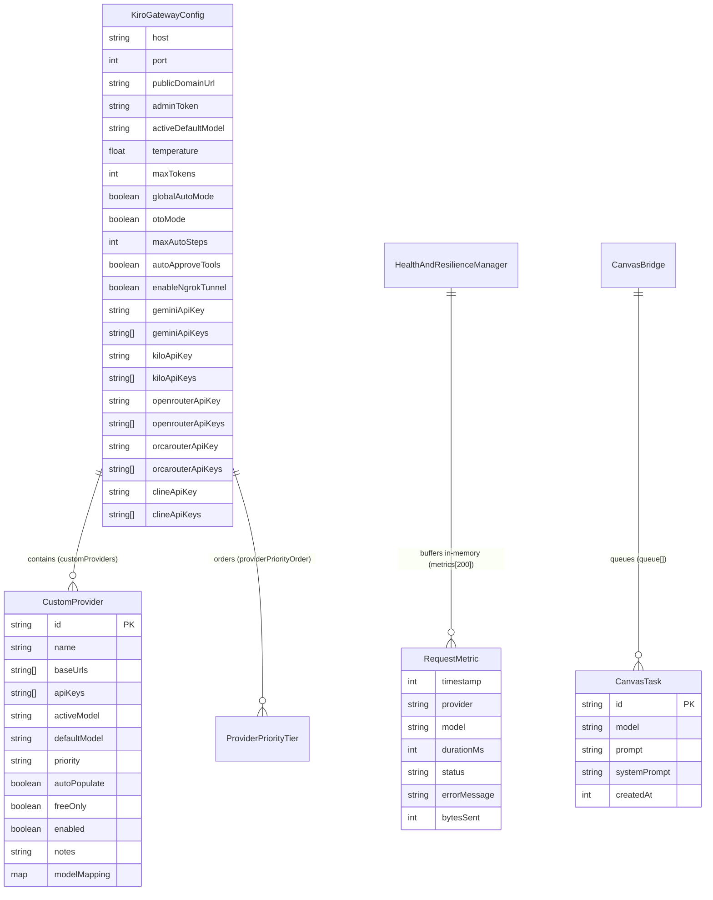

# Data Model & Schema Specifications

> **STORAGE ARCHITECTURE NOTICE (FACT):**
> This application does not use an external relational database (RDBMS) or ORM.
> State is divided between **JSON File Persistence with `/tmp` Fallback** and **In-Memory Volatile Queues/Buffers**.

---

## 1. Entity-Relationship Diagram



---

## 2. Entity Schemas & Constraints

### 1. `KiroGatewayConfig` (Core Configuration Entity)
* **Defined In (FACT)**: [`src/backend/config/index.ts:21-55`](file:///d:/sdlc_studio/projects/kiro-integration/tmp_cloud_audit/src/backend/config/index.ts#L21-L55).
* **Persistence Location (FACT)**:
  1. `config/kiro_ai_config.local.json` (Local developer override)
  2. `config/kiro_ai_config.json` (Primary configuration baseline)
  3. `/tmp/kiro_ai_config.json` (Cloud Run container write fallback)
* **Field Constraints**:
  - `providerPriorityOrder`: Non-empty array of strings. Default: `['kilo', 'cline', 'openrouter', 'orcarouter', 'gemini', 'custom', 'canvas']` ([`config/index.ts:99-102`](file:///d:/sdlc_studio/projects/kiro-integration/tmp_cloud_audit/src/backend/config/index.ts#L99-L102)).
  - `temperature`: Float between `0.0` and `2.0`. Default: `0.7`.
  - `maxTokens`: Integer. Default: `4096`.
  - `globalAutoMode`: Boolean flag. When `true`, automatically prompts the model to execute tools autonomously ([`src/backend/handlers/bedrock_handler.ts:98-103`](file:///d:/sdlc_studio/projects/kiro-integration/tmp_cloud_audit/src/backend/handlers/bedrock_handler.ts#L98-L103)).

---

### 2. `CustomProvider` (External OpenAI Upstream Entity)
* **Defined In (FACT)**: [`src/backend/config/index.ts:4-19`](file:///d:/sdlc_studio/projects/kiro-integration/tmp_cloud_audit/src/backend/config/index.ts#L4-L19).
* **Normalization Logic (FACT)**: Handled by `normalizeCustomProvider()` ([`config/index.ts:57-90`](file:///d:/sdlc_studio/projects/kiro-integration/tmp_cloud_audit/src/backend/config/index.ts#L57-L90)).
  - Backward compatibility: If legacy string `baseUrl` is supplied, it is normalized to `baseUrls: [baseUrl]`.
  - Backward compatibility: If legacy string `apiKey` is supplied, it is normalized to `apiKeys: [apiKey]`.
  - Google endpoint auto-fix: `https://generativelanguage.googleapis.com` is automatically rewritten to `https://generativelanguage.googleapis.com/v1beta/openai` ([`config/index.ts:75-77`](file:///d:/sdlc_studio/projects/kiro-integration/tmp_cloud_audit/src/backend/config/index.ts#L75-L77)).

---

### 3. `RequestMetric` (Telemetry Record)
* **Defined In (FACT)**: [`src/backend/resilience/health.ts:4-12`](file:///d:/sdlc_studio/projects/kiro-integration/tmp_cloud_audit/src/backend/resilience/health.ts#L4-L12).
* **Persistence Location (FACT)**: In-memory array (`metrics[]`) inside `HealthAndResilienceManager`.
* **Constraints**:
  - Maximum capacity: 200 items (FIFO ring buffer: oldest records are evicted when length exceeds 200) ([`health.ts:71-73`](file:///d:/sdlc_studio/projects/kiro-integration/tmp_cloud_audit/src/backend/resilience/health.ts#L71-L73)).
  - Volatility: Resets to empty upon container restart.

---

### 4. `CanvasTask` (Reverse Worker Queue Item)
* **Defined In (FACT)**: [`src/backend/providers/canvas_bridge.ts:3-12`](file:///d:/sdlc_studio/projects/kiro-integration/tmp_cloud_audit/src/backend/providers/canvas_bridge.ts#L3-L12).
* **Persistence Location (FACT)**: In-memory FIFO array (`queue[]`) inside `CanvasBridge`.
* **Constraints**:
  - `id`: Auto-generated string (`task_${random}_${Date.now()}`) ([`canvas_bridge.ts:47`](file:///d:/sdlc_studio/projects/kiro-integration/tmp_cloud_audit/src/backend/providers/canvas_bridge.ts#L47)).
  - Lifespan: Strictly bounded by a 20,000ms timeout. Evicted on completion (`/done`), error, or timeout ([`canvas_bridge.ts:61-64`](file:///d:/sdlc_studio/projects/kiro-integration/tmp_cloud_audit/src/backend/providers/canvas_bridge.ts#L61-L64)).

---

## 3. Schema Evolution & Migration Rules

When adding new properties to `KiroGatewayConfig` or `CustomProvider`:

1. **Always Provide Sensible Defaults**:
   Add the default value inside `DEFAULT_CONFIG` in [`src/backend/config/index.ts:94-123`](file:///d:/sdlc_studio/projects/kiro-integration/tmp_cloud_audit/src/backend/config/index.ts#L94-L123). Existing JSON files on disk lacking the new key must not crash.
2. **Support Non-Destructive Merging**:
   In `ConfigManager.loadInitialConfig()`, ensure the property is spread safely:
   ```ts
   this.config = {
     ...this.config,
     ...fileConfig,
     newProperty: process.env.NEW_PROPERTY ?? fileConfig.newProperty ?? DEFAULT_CONFIG.newProperty,
   };
   ```
3. **Synchronize Frontend Interfaces**:
   Mirror every schema change immediately into [`src/frontend/types.ts`](file:///d:/sdlc_studio/projects/kiro-integration/tmp_cloud_audit/src/frontend/types.ts).
4. **Never Store Unmasked Sensitive Secrets in Source Control**:
   Template and example files (`config/kiro_ai_config.example.json`) must maintain empty strings or placeholders (`""`) for all API keys.
