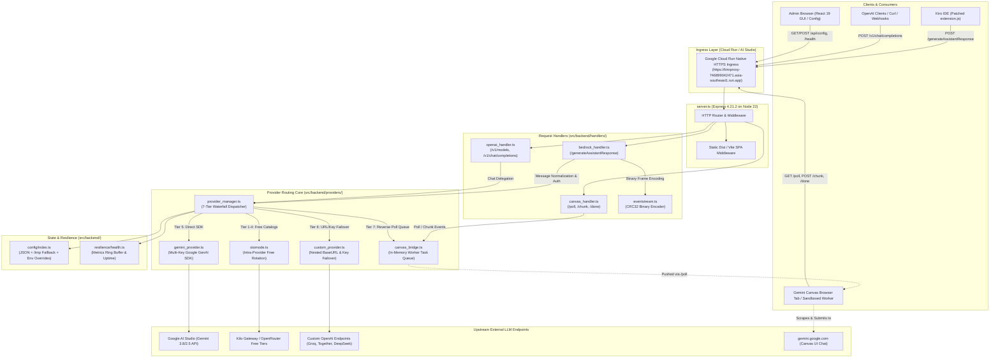

# System Map — KiroProxy Cloud Gateway Architecture

## 1. Component & Data Flow Diagram

---

## 2. Module Inventory & Dependency Matrix

| Module Path | Responsibility | Depends On | Depended On By | Status |
| :--- | :--- | :--- | :--- | :--- |
| [`server.ts`](file:///d:/sdlc_studio/projects/kiro-integration/tmp_cloud_audit/server.ts) | Express HTTP bootstrap, route binding, CORS, and static SPA serving | `express`, `config/index.ts`, `health.ts`, `bedrock_handler.ts`, `openai_handler.ts`, `canvas_handler.ts`, `provider_manager.ts` | Process entry point (`Dockerfile`, `package.json`) | **FACT** ([`server.ts:1-25`](file:///d:/sdlc_studio/projects/kiro-integration/tmp_cloud_audit/server.ts#L1-L25)) |
| [`src/backend/config/index.ts`](file:///d:/sdlc_studio/projects/kiro-integration/tmp_cloud_audit/src/backend/config/index.ts) | Configuration lifecycle, file read/write with `/tmp` fallback, and stateless env var merging | `node:fs`, `node:path` | `server.ts`, `bedrock_handler.ts`, `health.ts`, `provider_manager.ts`, `gemini_provider.ts`, `custom_provider.ts`, `otomode.ts` | **FACT** ([`config/index.ts:130-255`](file:///d:/sdlc_studio/projects/kiro-integration/tmp_cloud_audit/src/backend/config/index.ts#L130-L255)) |
| [`src/backend/resilience/health.ts`](file:///d:/sdlc_studio/projects/kiro-integration/tmp_cloud_audit/src/backend/resilience/health.ts) | Real-time health metrics, Cloud Run detection, request duration telemetry, and uptime calculation | `node:os`, `config/index.ts` | `server.ts`, `provider_manager.ts` | **FACT** ([`health.ts:14-118`](file:///d:/sdlc_studio/projects/kiro-integration/tmp_cloud_audit/src/backend/resilience/health.ts#L14-L118)) |
| [`src/backend/handlers/bedrock_handler.ts`](file:///d:/sdlc_studio/projects/kiro-integration/tmp_cloud_audit/src/backend/handlers/bedrock_handler.ts) | Intercepts Kiro IDE requests, normalizes conversation payloads, enforces admin auth token | `eventstream.ts`, `provider_manager.ts`, `config/index.ts`, `gemini_provider.ts` | `server.ts` | **FACT** ([`bedrock_handler.ts:34-140`](file:///d:/sdlc_studio/projects/kiro-integration/tmp_cloud_audit/src/backend/handlers/bedrock_handler.ts#L34-L140)) |
| [`src/backend/handlers/eventstream.ts`](file:///d:/sdlc_studio/projects/kiro-integration/tmp_cloud_audit/src/backend/handlers/eventstream.ts) | Encodes string deltas and tool blocks into AWS Bedrock binary EventStream frames with CRC32 | Native `Buffer`, `Uint8Array`, IEEE 802.3 CRC32 precomputed table | `bedrock_handler.ts` | **FACT** ([`eventstream.ts:7-96`](file:///d:/sdlc_studio/projects/kiro-integration/tmp_cloud_audit/src/backend/handlers/eventstream.ts#L7-L96)) |
| [`src/backend/handlers/canvas_handler.ts`](file:///d:/sdlc_studio/projects/kiro-integration/tmp_cloud_audit/src/backend/handlers/canvas_handler.ts) | HTTP endpoints (`/poll`, `/chunk`, `/done`, `/api/canvas/status`) for browser reverse-polling worker | `canvas_bridge.ts` | `server.ts` | **FACT** ([`canvas_handler.ts:1-70`](file:///d:/sdlc_studio/projects/kiro-integration/tmp_cloud_audit/src/backend/handlers/canvas_handler.ts#L1-L70)) |
| [`src/backend/handlers/openai_handler.ts`](file:///d:/sdlc_studio/projects/kiro-integration/tmp_cloud_audit/src/backend/handlers/openai_handler.ts) | Emulates OpenAI `/v1/models` and `/v1/chat/completions` over SSE | `config/index.ts`, `provider_manager.ts`, `bedrock_handler.ts` | `server.ts` | **FACT** ([`openai_handler.ts:1-90`](file:///d:/sdlc_studio/projects/kiro-integration/tmp_cloud_audit/src/backend/handlers/openai_handler.ts#L1-L90)) |
| [`src/backend/providers/provider_manager.ts`](file:///d:/sdlc_studio/projects/kiro-integration/tmp_cloud_audit/src/backend/providers/provider_manager.ts) | Central router: 7-tier waterfall, direct prefix matching, and diagnostic setup fallback | `config/index.ts`, `health.ts`, `gemini_provider.ts`, `custom_provider.ts`, `canvas_bridge.ts`, `otomode.ts` | `server.ts`, `bedrock_handler.ts`, `openai_handler.ts` | **FACT** ([`provider_manager.ts:16-282`](file:///d:/sdlc_studio/projects/kiro-integration/tmp_cloud_audit/src/backend/providers/provider_manager.ts#L16-L282)) |
| [`src/backend/providers/gemini_provider.ts`](file:///d:/sdlc_studio/projects/kiro-integration/tmp_cloud_audit/src/backend/providers/gemini_provider.ts) | Official Google GenAI SDK interface with sticky multi-key failover rotation on 429 errors | `@google/genai`, `config/index.ts` | `provider_manager.ts`, `otomode.ts` | **FACT** ([`gemini_provider.ts:24-128`](file:///d:/sdlc_studio/projects/kiro-integration/tmp_cloud_audit/src/backend/providers/gemini_provider.ts#L24-L128)) |
| [`src/backend/providers/custom_provider.ts`](file:///d:/sdlc_studio/projects/kiro-integration/tmp_cloud_audit/src/backend/providers/custom_provider.ts) | Nested failover execution across multiple base URLs and multiple API keys for external endpoints | Native `fetch`, `config/index.ts` | `provider_manager.ts` | **FACT** ([`custom_provider.ts:8-66`](file:///d:/sdlc_studio/projects/kiro-integration/tmp_cloud_audit/src/backend/providers/custom_provider.ts#L8-L66)) |
| [`src/backend/providers/otomode.ts`](file:///d:/sdlc_studio/projects/kiro-integration/tmp_cloud_audit/src/backend/providers/otomode.ts) | Rotates through curated catalogs of free models for Kilo, OpenRouter, Cline, Orca, and Gemini | `config/index.ts`, `gemini_provider.ts` | `provider_manager.ts` | **FACT** ([`otomode.ts:61-150`](file:///d:/sdlc_studio/projects/kiro-integration/tmp_cloud_audit/src/backend/providers/otomode.ts#L61-L150)) |
| [`src/backend/providers/canvas_bridge.ts`](file:///d:/sdlc_studio/projects/kiro-integration/tmp_cloud_audit/src/backend/providers/canvas_bridge.ts) | In-memory job queue and event distribution for reverse-polling Gemini Canvas workers | `node:events` | `provider_manager.ts`, `canvas_handler.ts` | **FACT** ([`canvas_bridge.ts:26-140`](file:///d:/sdlc_studio/projects/kiro-integration/tmp_cloud_audit/src/backend/providers/canvas_bridge.ts#L26-L140)) |
| [`src/App.tsx`](file:///d:/sdlc_studio/projects/kiro-integration/tmp_cloud_audit/src/App.tsx) | Root React component managing active tabs, configuration state, and auto-refresh loops | React 19, `lucide-react`, frontend components | Mount point in `main.tsx` | **FACT** ([`src/App.tsx:1-120`](file:///d:/sdlc_studio/projects/kiro-integration/tmp_cloud_audit/src/App.tsx#L1-L120)) |
| [`scripts/patch_kiro_extension.js`](file:///d:/sdlc_studio/projects/kiro-integration/tmp_cloud_audit/scripts/patch_kiro_extension.js) | Standalone CLI tool that surgically patches Kiro IDE's `extension.js` bundle | `node:fs`, `node:path`, `node:os` | Run on developer workstations | **FACT** ([`scripts/patch_kiro_extension.js:1-360`](file:///d:/sdlc_studio/projects/kiro-integration/tmp_cloud_audit/scripts/patch_kiro_extension.js#L1-L360)) |

---

## 3. Entry Points & Ingress Paths

1. **HTTP / API Server Entry Point**: `tsx server.ts` binds to `0.0.0.0:${PORT:-3000}` ([`server.ts:314-317`](file:///d:/sdlc_studio/projects/kiro-integration/tmp_cloud_audit/server.ts#L314-L317)).
2. **Kiro IDE Bedrock Streaming**: `POST /generateAssistantResponse` or `POST /k/:token/generateAssistantResponse` ([`server.ts:48-49`](file:///d:/sdlc_studio/projects/kiro-integration/tmp_cloud_audit/server.ts#L48-L49)).
3. **OpenAI Compatible Client**: `POST /v1/chat/completions` or `POST /k/:token/v1/chat/completions` ([`server.ts:194-195`](file:///d:/sdlc_studio/projects/kiro-integration/tmp_cloud_audit/server.ts#L194-L195)).
4. **Canvas Reverse Worker**: `GET /poll`, `POST /chunk`, `POST /done` ([`server.ts:198-200`](file:///d:/sdlc_studio/projects/kiro-integration/tmp_cloud_audit/server.ts#L198-L200)).
5. **Control Center Web GUI**: `GET /` serves compiled Vite assets from `dist/index.html` ([`server.ts:288-295`](file:///d:/sdlc_studio/projects/kiro-integration/tmp_cloud_audit/server.ts#L288-L295)).

---

## 4. Background Jobs & Timers

* **Canvas Task Timeout**: An in-memory 20,000ms timer (`setTimeout`) triggers task cleanup and rejection if a polling worker fails to respond ([`src/backend/providers/canvas_bridge.ts:61-64`](file:///d:/sdlc_studio/projects/kiro-integration/tmp_cloud_audit/src/backend/providers/canvas_bridge.ts#L61-L64)).
* **HTTP Fetch Timeout**: Outgoing custom provider requests use an `AbortController` set to 45,000ms ([`src/backend/providers/custom_provider.ts:107-108`](file:///d:/sdlc_studio/projects/kiro-integration/tmp_cloud_audit/src/backend/providers/custom_provider.ts#L107-L108)).
* **Frontend Health Polling**: The React Web GUI polls `/api/health` and `/api/status` every 3,000ms ([`src/App.tsx:40-60`](file:///d:/sdlc_studio/projects/kiro-integration/tmp_cloud_audit/src/App.tsx#L40-L60)).

---

## 5. External Services & Upstream Integration

1. **Google AI Studio / Gemini API**: Directly queried via `@google/genai` using `GEMINI_API_KEY` ([`src/backend/providers/gemini_provider.ts:93`](file:///d:/sdlc_studio/projects/kiro-integration/tmp_cloud_audit/src/backend/providers/gemini_provider.ts#L93)).
2. **Kilo Gateway & OpenRouter**: Free-tier completions queried via HTTP at `https://api.kilo.ai/v1` and `https://openrouter.ai/api/v1` ([`src/backend/providers/otomode.ts:75-78`](file:///d:/sdlc_studio/projects/kiro-integration/tmp_cloud_audit/src/backend/providers/otomode.ts#L75-L78)).
3. **External Custom APIs**: Groq, Together, DeepSeek, or private tunnels queried over standard OpenAI `/chat/completions` wire format ([`src/backend/providers/custom_provider.ts:75-88`](file:///d:/sdlc_studio/projects/kiro-integration/tmp_cloud_audit/src/backend/providers/custom_provider.ts#L75-L88)).
4. **Google Cloud Run Infrastructure**: Managed container runtime with environment metadata injected via `K_SERVICE` ([`src/backend/resilience/health.ts:53-55`](file:///d:/sdlc_studio/projects/kiro-integration/tmp_cloud_audit/src/backend/resilience/health.ts#L53-L55)).
